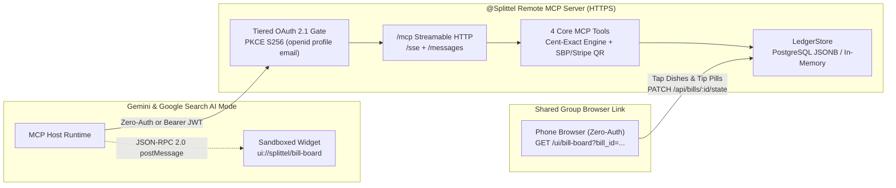

# Splittel (`@Splittel`) — Remote MCP Server for Google Connected Apps

> **Мгновенный расчет общих чеков, расходов и долгов с распознаванием фото, умным учетом чаевых и интерактивной карточкой оплаты прямо в диалоге.**

Production-ready **Remote Model Context Protocol (MCP) Server** built with **Node.js, TypeScript, Express 5, `@modelcontextprotocol/sdk`, and Tailwind CSS v4**, engineered for **Google Connected Apps (Gemini & Google Search AI Mode)** over **HTTPS**.

---

## Architecture & User Scenarios



- **Scenario A (Multimodal Photo + Dictation)**: Gemini/Search extracts receipt items, tax, and natural-language ownership; `parse_and_split_bill` computes cent-exact proportional totals.
- **Scenario B (Interactive Sandboxed Widget)**: `ui://splittel/bill-board` renders inline with tip selector pills (`0%`, `10%`, `15%`, `Custom`), an itemized dish-to-avatar matrix, per-person summary cards, `"Mark as Paid"` toggle, and `"Pay via Link / SBP QR"` modal.
- **Scenario C (Group Link Sharing)**: Every parsed check generates a shareable `share_url` (`/ui/bill-board?bill_id=...`) where friends can tap their dishes on mobile browsers without logging in.
- **Scenario D (Multi-Currency FX Settlement)**: Supports cross-currency receipts and travel ledgers (e.g., check in `EUR`, `USD`, `TRY`, `THB`, `AED`, `GEL` settled in `RUB` via SBP) using `currency`, `settlement_currency`, and optional `exchange_rate` with zero kopek/cent drift.

---

## MCP Tools & Tiered OAuth 2.1 Security

| Tool | Safety Annotation | Auth Tier | Key Inputs |
| :--- | :--- | :--- | :--- |
| `parse_and_split_bill` | `readOnlyHint: true` | **Free Tier (Zero-Auth)** | `raw_items`, `people`, optional `assignments`, `tip_percentage` (`10`), `tax_amount` (`0`), `currency`, `settlement_currency`, `exchange_rate` → returns `meta: { ui: { resourceUri: "ui://splittel/bill-board" } }` |
| `calculate_group_balance` | `readOnlyHint: true` | **Free Tier (Zero-Auth)** | `expenses`: `Array<{ description?, paid_by, amount, split_among, currency?, exchange_rate? }>`, optional `settlement_currency` |
| `generate_payment_card` | `readOnlyHint: true` | **Free Tier (Zero-Auth)** | `settlements`: `Array<{ debtor, creditor, amount, currency?, payment_link? }>`, optional `settlement_currency`, `exchange_rate` → SBP, Stripe & SVG QR |
| `settle_up_action` | `destructiveHint: true` | **Account Linking (`openid profile email`)** | `transaction_id`, `status: "PAID" \| "CANCELLED"` |

### Account-Linked Endpoints (OAuth 2.1 Bearer Required)
- `GET /userinfo` — OIDC profile claims (`openid`, `profile`, `email`).
- `GET /api/account/history` & `POST /api/account/history` — Save and list personal bill history.
- `GET /api/account/payment-profile` & `PUT /api/account/payment-profile` — Configure personal SBP phone/bank and Stripe payment links.
- **Google Auth Platform Client Flag**: Pre-configured OAuth client `google-connected-apps` sets `"use_this_client_for_an_ai_powered_agent": true`.

---

## Quick Start & MCP Inspector Verification

```bash
pnpm install
pnpm run build
pnpm test
pnpm start
# HTTPS Server: https://localhost:3443/mcp
# Interactive Widget: https://localhost:3443/ui/bill-board

# Verify tools, strict schemas & UI widget via @modelcontextprotocol/inspector:
pnpm run inspect:tools
pnpm run inspect:ui
pnpm run inspect:web
```

---

## HTTPS Cloud Deployment (Cloud Run / Railway / Render)

- **Live Production URL (Railway)**:
  - Web UI / Bill Board: `https://splittel-production.up.railway.app/ui/bill-board`
  - Streamable HTTP MCP: `https://splittel-production.up.railway.app/mcp`
  - SSE MCP: `https://splittel-production.up.railway.app/sse`
  - Healthcheck: `https://splittel-production.up.railway.app/health`
  - Well-known Discovery: `https://splittel-production.up.railway.app/.well-known/mcp.json`
- **Google Cloud Run**: `GCP_PROJECT_ID=your-project ./scripts/deploy-cloud-run.sh` (or CI/CD via `cloudbuild.yaml`).
- **Railway**: Uses `railway.json` + `Dockerfile` (auto-binds `RAILWAY_PUBLIC_DOMAIN` to `PUBLIC_BASE_URL` & OAuth 2.1 metadata).
- **Render**: Blueprint in `render.yaml` (auto-binds `RENDER_EXTERNAL_URL` to `PUBLIC_BASE_URL` & OAuth 2.1 metadata).
